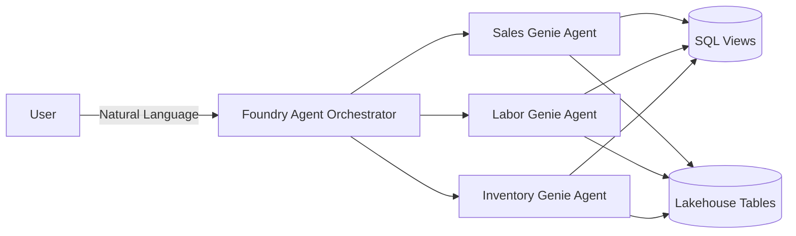

# Retail Store Intelligence

Analyzes real-time and historical store data across sales, inventory, and labor to surface actionable insights, risks, and opportunities through conversational AI agents.

## Implementations

This repo contains three agent orchestration patterns, each covering sales, labor, and inventory:

| # | Orchestrator | Backend Agents |
|---|---|---|
| 1 | Copilot Studio | Fabric Data Agents |
| 2 | Azure AI Foundry Agent | Fabric Data Agents |
| 3 | Azure AI Foundry Agent | Databricks Genie Agents |

## Architecture

### Option 1: Copilot Studio + Fabric Data Agents

- No-code orchestrator configured via system prompt and topic definitions
- Routes questions to the appropriate Fabric Data Agent based on domain (sales, inventory, labor)
- Supports multi-agent fan-out for cross-domain queries (e.g. "morning briefing", "store health check")
- Built-in topic templates: morning briefing, risk summary, store health check
- Fabric Data Agents are called as Copilot Studio actions

### Option 2: Foundry Agent + Fabric Data Agents

- Python-based orchestrator hosted on Azure AI Foundry
- Uses Azure AI Agent SDK with function-calling tools bound to each Fabric Data Agent
- Authenticates to Fabric via MSAL client credentials and calls published agent REST endpoints
- Supports automatic multi-agent routing and cross-domain synthesis
- Fully code-driven — customizable routing logic and response formatting

### Option 3: Foundry Agent + Databricks Genie Agents

- Python-based orchestrator hosted on Azure AI Foundry
- Calls Databricks Genie Spaces via the Conversation API (start-conversation + polling)
- Each Genie Space is configured with its own SQL views and table context for text-to-SQL
- Genie generates and executes SQL autonomously; results are returned as structured tables
- Async polling with exponential backoff (up to 5-minute timeout per query)

## Repo Structure

| Folder | Purpose |
|--------|---------|
| `sql/views/` | SQL views (inventory health, labor coverage, OOS classification, OSA daily, sales summary) |
| `dataagents/` | Fabric Data Agents — one per domain (sales, labor, inventory) |
| `copilot_studio/` | Copilot Studio orchestrator instructions and topics |
| `foundry_agent/` | Azure AI Foundry orchestrator agent |
| `databricks_genie/` | Databricks Genie agents + Foundry orchestrator for Genie backend |

## Getting Started

See [SETUP_GUIDE.md](SETUP_GUIDE.md) for deployment instructions.
