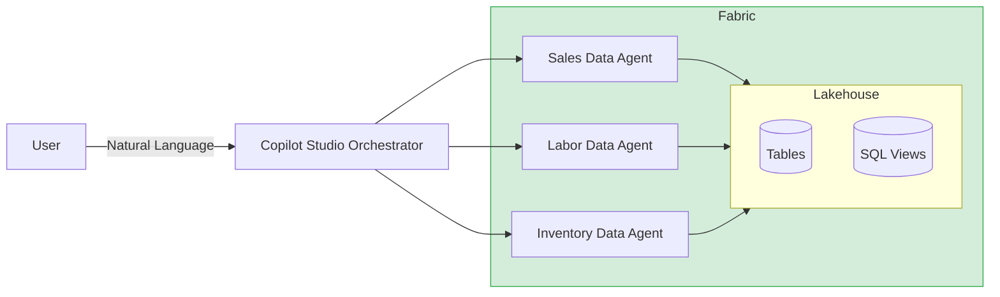
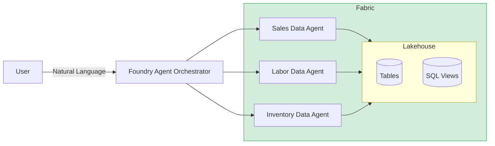

# Retail Store Intelligence

Analyzes real-time and historical store data across sales, inventory, and labor to surface actionable insights, risks, and opportunities through conversational AI agents.

## Key Features

- **Morning briefing** — automated cross-domain daily summary of sales, inventory, and staffing
- **Store health check** — unified view of any store's performance across all three domains
- **Risk surfacing** — proactive detection of stockouts, understaffing, and sales declines
- **Multi-agent fan-out** — queries are routed to specialized domain agents and synthesized into a single response
- **2 deployment options** — Copilot Studio (no-code) or Foundry + Fabric (code-driven)
- **Pre-built SQL views** — five analytical views covering sales summary, inventory health, OSA, OOS classification, and labor coverage

## Implementations

This repo contains two agent orchestration patterns, each covering sales, labor, and inventory:

| # | Orchestrator | Backend Agents |
|---|---|---|
| 1 | Copilot Studio | Fabric Data Agents |
| 2 | Azure AI Foundry Agent | Fabric Data Agents |

## Architecture

### Option 1: Copilot Studio + Fabric Data Agents

- No-code orchestrator configured via system prompt and topic definitions
- Routes questions to the appropriate Fabric Data Agent based on domain (sales, inventory, labor)
- Fabric Data Agents are added as connected agents in Copilot Studio 
- Supports multi-agent fan-out for cross-domain queries (e.g. "morning briefing", "store health check")
- Built-in topic templates: morning briefing, risk summary, store health check

### Option 2: Foundry Agent + Fabric Data Agents

- Authenticates to Fabric via MSAL client credentials and calls published agent REST endpoints
- Supports automatic multi-agent routing and cross-domain synthesis
- Fully code-driven — customizable routing logic and response formatting

## Repo Structure

| Folder | Purpose |
|--------|---------|
| `sql/views/` | SQL views (inventory health, labor coverage, OOS classification, OSA daily, sales summary) |
| `dataagents/` | Fabric Data Agents — one per domain (sales, labor, inventory) |
| `copilot_studio/` | Copilot Studio orchestrator instructions and topics |
| `foundry_agent/` | Azure AI Foundry orchestrator agent |
| `recommendations/regional_manager_briefing.ipynb` | Fabric notebook — weekly podcast-style briefing per region, written to OneLake `RegionalManagerBriefing/` |

## Getting Started

See [SETUP_GUIDE.md](SETUP_GUIDE.md) for deployment instructions.
