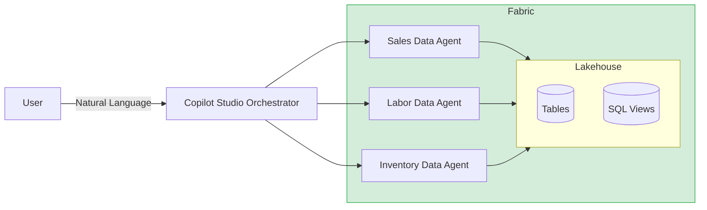
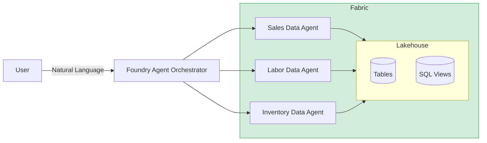
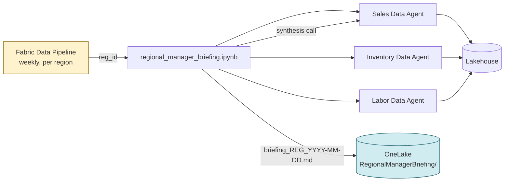

# Retail Store Intelligence

Analyzes real-time and historical store data across sales, inventory, and labor to surface actionable insights, risks, and opportunities through conversational AI agents.

## Key Features

- **Morning briefing** — automated cross-domain daily summary of sales, inventory, and staffing
- **Store health check** — unified view of any store's performance across all three domains
- **Risk surfacing** — proactive detection of stockouts, understaffing, and sales declines
- **Multi-agent fan-out** — queries are routed to specialized domain agents and synthesized into a single response
- **Weekly regional manager briefing** — podcast-style narrative + structured weekly performance snapshot, generated per region and persisted to OneLake
- **2 deployment options** — Copilot Studio (no-code) or Foundry + Fabric (code-driven)
- **Pre-built SQL views** — five analytical views covering sales summary, inventory health, OSA, OOS classification, and labor coverage

## Implementations

This repo contains two agent orchestration patterns, each covering sales, labor, and inventory:

| # | Orchestrator | Backend Agents |
|---|---|---|
| 1 | Copilot Studio | Fabric Data Agents |
| 2 | Azure AI Foundry Agent | Fabric Data Agents |

## Architecture

### Option 1: Copilot Studio + Fabric Data Agents

- No-code orchestrator configured via system prompt and topic definitions
- Routes questions to the appropriate Fabric Data Agent based on domain (sales, inventory, labor)
- Fabric Data Agents are added as connected agents in Copilot Studio 
- Supports multi-agent fan-out for cross-domain queries (e.g. "morning briefing", "store health check")
- Built-in topic templates: morning briefing, risk summary, store health check

### Option 2: Foundry Agent + Fabric Data Agents

- Authenticates to Fabric via MSAL client credentials and calls published agent REST endpoints
- Supports automatic multi-agent routing and cross-domain synthesis
- Fully code-driven — customizable routing logic and response formatting

## Recommendations

Two notebook-driven recommendation flows complement the conversational agents — one daily and per-store, one weekly and per-region.

### Daily Store Recommendations — [`recommendations/agent_driven_recommendations.ipynb`](recommendations/agent_driven_recommendations.ipynb)

Generates holistic, dollar-quantified, SKU-level recommendations for a single store by fanning out to the Sales, Labor, and Inventory Fabric Data Agents via the `fabric-data-agent-sdk`. Each agent returns structured JSON (risks, opportunities, KPIs, top-2 SKUs); results are merged and persisted to `retail.recommendations`, which is consumed by the Recommendation Data Agent.

- **Inputs:** `store_id`, `report_date`, `lookback_days`
- **Output:** rows in `retail.recommendations` (idempotent on `(str_id, report_date)`)
- **Scheduling:** daily Fabric Data Pipeline, one notebook activity per store

### Weekly Regional Manager Briefing — [`recommendations/regional_manager_briefing.ipynb`](recommendations/regional_manager_briefing.ipynb)

Produces a two-part weekly markdown briefing for a single region:

- **Part 1 — Weekly Podcast** — a 7–10 sentence conversational narrative, as if a colleague is verbally briefing the regional manager. Covers the week's hook, sales WoW, department trends, OSA / OOS posture, staffing risks, cross-domain connections, and what to watch next week.
- **Part 2 — Weekly Performance Snapshot** — structured markdown sections:
  - **Key Metrics & Department Read** (Sales agent) — revenue, orders, margin, top/bottom departments
  - **Inventory Health** (Inventory agent) — TRUE_OOS / CHRONIC_OOS / PHANTOM_OOS / AT_RISK_OOS counts, OSA vs prior week, lowest-OSA stores
  - **Labor Coverage** (Labor agent) — headcount, understaffed stores, single-associate shifts, productivity

How it works:

1. Resolves the region from `retail.regions` in the lakehouse.
2. Fans out one prompt each to the Sales, Inventory, and Labor Fabric Data Agents (via the `fabric-data-agent-sdk`) for region-scoped sections.
3. Re-calls the Sales agent with the three section outputs as context to synthesize the Weekly Podcast narrative — no Azure OpenAI dependency.
4. Assembles the final markdown and writes `briefing_<reg_id>_<week_ending>.md` to OneLake under `RegionalManagerBriefing/`.

**Scheduling:** orchestrate via a Fabric Data Pipeline that fans out per region (one notebook activity per `reg_id`) on a weekly cadence.

## Repo Structure

| Folder | Purpose |
|--------|---------|
| `sql/views/` | SQL views (inventory health, labor coverage, OOS classification, OSA daily, sales summary) |
| `dataagents/` | Fabric Data Agents — one per domain (sales, labor, inventory) |
| `copilot_studio/` | Copilot Studio orchestrator instructions and topics |
| `foundry_agent/` | Azure AI Foundry orchestrator agent |
| `recommendations/agent_driven_recommendations.ipynb` | Fabric notebook — daily SKU-level store recommendations, written to `retail.recommendations` |
| `recommendations/regional_manager_briefing.ipynb` | Fabric notebook — weekly podcast-style briefing per region, written to OneLake `RegionalManagerBriefing/` |

## Getting Started

See [SETUP_GUIDE.md](SETUP_GUIDE.md) for deployment instructions.
